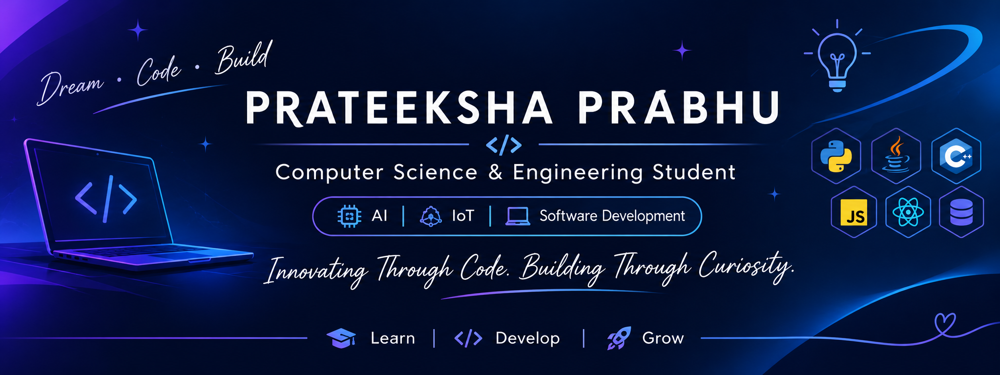

# Hi, I'm Prateeksha Prabhu 👋

### Computer Science Engineering Student | Aspiring Software Developer

Welcome to my GitHub profile!

I'm pursuing a Bachelor of Engineering in Computer Science and Engineering at Sri Krishna College of Engineering and Technology (SKCET), Coimbatore.

I'm passionate about software development, Artificial Intelligence, Data Science and building technology-driven solutions.

## 👩‍💻 About Me

- 🎓 B.E. Computer Science and Engineering | SKCET
- 💻 Internship experience in Data Science and Full Stack Development
- 🤖 Interested in Artificial Intelligence, Machine Learning and IoT
- 🌱 Continuously improving my programming and problem-solving skills
- 🚀 Exploring real-world projects and emerging technologies
- 🤝 Interested in internships, hackathons and technical research

## 🛠️ Tech Stack & Tools

### Programming Languages

### Frontend Development

### Backend & Database

### Data Science

### Tools

## 💼 Internship Experience

**Data Science Intern | Thiranex**

*May 2026 – June 2026*

- Data cleaning, preprocessing and visualization.
- Exploratory Data Analysis and predictive modelling.
- Worked with Python-based data science tools.

**Full Stack Development Intern | EdVyro IT Solutions**

*October 2026 – November 2026*

- Developed responsive web interfaces.
- Built REST APIs using Node.js and Express.js.
- Implemented CRUD operations, validation and pagination.
- Integrated frontend components with backend APIs.

## 🚀 Featured Projects

### 1. Internship Management API

- Developed a REST API for managing internship records.
- Built using Node.js, Express.js and SQLite.
- Implemented backend functionality for handling internship data.
- Designed API endpoints for managing internship records.

**Project Links:**

- [GitHub Repository](https://github.com/prateekshapk22-jpg/internship-management-api)

### 2. Responsive Internship Board

- Developed a responsive web application for exploring internship opportunities.
- Built using HTML5, CSS3 and Vanilla JavaScript.
- Displays internship opportunities dynamically using JSON data.
- Implemented keyword-based search across internship roles, companies, locations and descriptions.
- Added domain-based filtering to help users find relevant opportunities.
- Designed responsive layouts for desktop, tablet and mobile devices.

**Project Links:**

- [GitHub Repository](https://github.com/prateekshapk22-jpg/internship-board)
- [Live Website](https://prateekshapk22-jpg.github.io/internship-board/)

## 📜 Certifications

- Introduction to HTML – Simplilearn
- Getting Started with Artificial Intelligence – IBM

## 🏆 Achievements & Activities

- Participated in Smart India Hackathon (SIH) college-level selection.
- Served as Master of Ceremonies for college events.
- Participated in technical workshops and institutional programmes.

## 🎯 Current Goals

- Strengthen Java and Python programming skills.
- Develop practical full-stack applications.
- Explore Artificial Intelligence and Machine Learning.
- Participate in technical paper presentations and hackathons.
- Gain further industry experience.

## 🌐 Connect With Me

- 💼 LinkedIn: [Prateeksha Prabhu](https://www.linkedin.com/in/Prateeksha-Prabhu-986227381)
- 🐙 GitHub: [prateekshapk22-jpg](https://github.com/prateekshapk22-jpg)

---

## 📊 GitHub Statistics

  
  

  

---

⭐ *Learning continuously. Building consistently. Growing through technology.*
